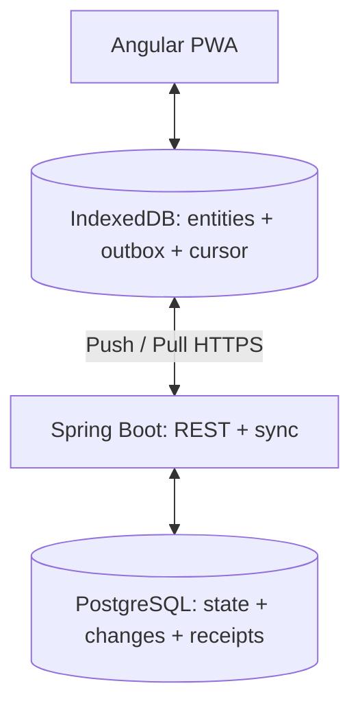

# Dayora — Product Foundation dan Batas Implementasi

**Status:** Draft revisi; rekomendasi implementasi untuk ditinjau.  
**Target:** Aplikasi produktivitas pribadi, local-first, open-source, self-hosted.  
**Versi dokumen:** 0.2 — 22 November 2026.  
**Tujuan:** Menyatukan visi produk, batas MVP, aturan domain, protokol sinkronisasi awal, dan kriteria penerimaan sebelum implementasi.

Dokumen ini membedakan **keputusan awal yang direkomendasikan**, **fitur yang ditunda**, dan **keputusan yang membutuhkan persetujuan**. Belum ada klaim bahwa aplikasi atau fitur di bawah sudah tersedia.

## 1. Ringkasan produk

Dayora menggabungkan kalender, task, focus timer, dan pencatatan waktu aktual. Pengalaman visual terinspirasi keramahan timetable Damda, dengan pengelolaan waktu yang lebih terstruktur. Identitas, ilustrasi, dan aset harus orisinal; bukan menyalin aplikasi lain.

Target akhir mencakup web, Android, dan Wear OS. Rilis pertama berfokus pada Web PWA agar manfaat harian dan sinkronisasi dapat dibuktikan sebelum menambah platform.

Alur utama:

1. Catat task di inbox.
2. Rencanakan pengerjaan melalui blok kalender.
3. Jalankan sesi fokus, opsional terkait task.
4. Bandingkan rencana dengan catatan waktu aktual.
5. Akses data lokal saat offline; sinkronkan ketika koneksi pulih.

### Prinsip

- Data milik pengguna; tersedia ekspor dan backup yang dapat dipulihkan.
- Fitur inti tidak bergantung pada layanan berlangganan.
- Tindakan lokal tidak menunggu respons jaringan.
- Perubahan yang belum tersinkronisasi tidak boleh hilang diam-diam.
- Kalender menyimpan rencana; time entry menyimpan realisasi.
- Task due date berbeda dari jadwal pengerjaan.
- Statistik membantu, bukan menghukum pengguna.
- Tambahkan platform dan kompleksitas hanya setelah kebutuhan terbukti.

Open-source tidak berarti tanpa biaya operasional. Server, domain, perangkat uji, dan distribusi tertentu dapat membutuhkan biaya.

## 2. Pengguna dan arah desain

### 2.1 Pengguna awal

Beberapa pengguna independen pada satu server, masing-masing dengan akun dan beberapa perangkat. Setiap pengguna hanya dapat melihat serta mengubah datanya sendiri. Tidak ada kolaborasi, organisasi, kalender bersama, atau registrasi publik pada MVP.

Admin server membuat akun melalui perintah administrasi/CLI; setiap pengguna login sendiri. `ownerId` mengikat semua data, perangkat, receipt, dan change log ke akun yang terautentikasi. Multi-user di sini berarti akun terpisah dengan isolasi data, bukan berbagi data antarakun.

### 2.2 Arah visual awal

**Rekomendasi:** visual ramah dan berwarna, fungsi produktivitas yang jelas.

- Halaman utama: ringkasan hari ini, agenda, task, status fokus.
- Kalender harian dan mingguan menjadi pusat perencanaan.
- Warna mendukung kategori, bukan satu-satunya pembeda informasi.
- Kontrol utama mudah diakses dengan sentuhan dan keyboard.
- Label, kontras, focus indicator, dan pembaca layar tetap diperhatikan.
- Animasi menghormati preferensi reduced motion.
- Maskot, gamification, dan tema tambahan ditunda.

## 3. Batas MVP v0.1

### Termasuk

| Area | Batas rilis pertama |
| --- | --- |
| Platform | Web PWA, browser desktop dan Android yang diuji |
| Akun | Multi-user terisolasi; admin membuat akun, login online, akses data lokal masing-masing saat offline |
| Task | Inbox, judul, catatan teks, prioritas, due date, selesai/belum selesai, hapus |
| Kalender | Tampilan hari/minggu, buat/edit/hapus time block melalui formulir |
| Relasi | Time block opsional terkait task; satu task dapat dijadwalkan beberapa kali |
| Fokus | Durasi kerja/istirahat yang dapat dipilih, start/pause/resume/complete/cancel |
| Waktu aktual | Riwayat fokus dan time entry manual; total durasi harian sederhana |
| Offline | Task, time block, timer, dan time entry lokal tetap dapat digunakan |
| Sync | Outbox persisten, push/pull otomatis ketika aplikasi aktif, tombol sync manual |
| Pemulihan | Ekspor JSON, backup database, prosedur restore teruji |
| Operasional | Docker Compose, HTTPS, health check, migrasi database |

### Tidak termasuk

- Android Capacitor dan aplikasi Wear OS produksi.
- Tampilan bulanan, drag-and-drop, resize kalender.
- Recurring schedule/task, subtask, habit, streak, achievement.
- Integrasi kalender eksternal, lampiran, rich text.
- Kolaborasi, registrasi publik, organisasi, berbagi kalender.
- WebSocket, push notification lintas perangkat, sinkronisasi background yang dijamin.
- Analitik mendalam, widget, tema tambahan.
- Notifikasi timer yang dijamin saat browser ditutup atau OS menangguhkan aplikasi.

**Batas penting:** PWA dapat memulihkan hitungan timer setelah dibuka kembali. Itu tidak menjamin alarm berbunyi tepat waktu ketika aplikasi ditutup. Jika alarm latar belakang yang andal wajib untuk penggunaan harian, rilis Android native bridge menjadi syarat rilis tersebut, bukan janji fitur PWA.

## 4. Platform dan teknologi

| Komponen | Pilihan awal | Alasan/batas |
| --- | --- | --- |
| Web | Angular + TypeScript | Basis UI utama, mobile-first, PWA |
| UI | Angular Material | Kontrol aksesibel siap pakai; jangan gabungkan framework UI kedua tanpa kebutuhan |
| Android | Angular UI + Capacitor WebView | Tampilan dan alur terasa seperti aplikasi native; bukan browser/PWA biasa |
| Penyimpanan web | IndexedDB | Data lokal dan outbox transaksional; bukan sekadar cache |
| Penyimpanan Android | SQLite melalui Capacitor/native bridge | Penyimpanan offline terstruktur; perlu diuji saat process death dan upgrade |
| Backend | Spring Boot, Java 21 | REST, validasi, otorisasi, koordinasi sync |
| Database | PostgreSQL | State terkini, deduplikasi operasi, change log |
| Migrasi | Flyway | Migrasi schema server yang terlacak |
| Deployment | Docker Compose | Satu server; tanpa Kubernetes atau microservices |
| Android berikutnya | Capacitor + SQLite + bridge native seperlunya | UI bersama; background/alarm perlu pembuktian perangkat nyata |
| Wear OS berikutnya | Kotlin + Compose for Wear OS + Room | UI native ringkas dan penyimpanan offline |

Pilih rilis dependency yang masih didukung saat implementasi; kunci versinya di repository. Jangan menambahkan dependency untuk kebutuhan yang sudah ditangani platform atau dependency terpasang.

IndexedDB dan SQLite tidak memiliki implementasi yang identik. Gunakan kontrak operasi data minimal saat platform kedua benar-benar ditambahkan; jangan membangun framework penyimpanan generik pada MVP.

## 5. Arsitektur awal



- UI membaca state lokal dan menyimpan perubahan secara lokal terlebih dahulu.
- API adalah koordinator revisi server, bukan prasyarat setiap interaksi UI.
- Backend berupa satu aplikasi modular, bukan sync microservice terpisah.
- REST CRUD terpisah tidak boleh memotong aturan revisi/change log; semua mutasi mengikuti satu jalur transaksi yang konsisten.
- Service worker menyimpan aset aplikasi. IndexedDB menyimpan data pengguna; keduanya memiliki siklus migrasi berbeda.
- WebSocket belum diperlukan. Jika ditambahkan, gunakan sebagai sinyal untuk pull, bukan satu-satunya pembawa perubahan.

## 6. Model domain minimal

Semua ID entity dibuat client menggunakan UUID. Entity yang tersinkronisasi memiliki `id`, `ownerId`, `revision`, `createdAt`, `updatedAt`, dan `deletedAt` nullable. Revisi kanonis ditentukan server; metadata lokal tidak mengubah revisi server.

| Entity | Data khusus utama | Aturan |
| --- | --- | --- |
| User | Username unik ternormalisasi, passwordHash, timezone, status | Banyak akun independen; kredensial tidak masuk sync/ekspor |
| Device | Nama, credential/session metadata, lastSeenAt, revokedAt | Identitas perangkat bukan bukti autentikasi |
| Task | title, notes, priority, dueDate, completedAt | dueDate berupa tanggal, bukan waktu mulai |
| CalendarEvent | title, startsAt, endsAt, timeZone, taskId opsional | endsAt harus lebih besar dari startsAt |
| FocusSession | taskId opsional, kind, durationSeconds, status, timing state | Transisi status tervalidasi |
| TimeEntry | taskId opsional, startsAt, endsAt, source, focusSessionId opsional | Durasi positif; satu hasil otomatis per sesi |
| SyncOperation | operationId, entityId, baseRevision, payload, status | Outbox lokal persisten |
| OperationReceipt | ownerId, operationId, result, requestHash | Deduplikasi operasi di server |
| ChangeLog | ownerId, sequence, entity snapshot/tombstone | Sumber pull incremental |

`SyncOperation` lokal berbeda dari `OperationReceipt` server. Change log untuk distribusi state bukan event sourcing penuh.

### Aturan task dan kalender

- Judul task/time block wajib tidak kosong; panjang dan ukuran payload dibatasi di client serta server.
- Prioritas: `NONE`, `LOW`, `MEDIUM`, `HIGH`.
- Task dapat memiliki beberapa time block tanpa mengubah deadline.
- Menyelesaikan task tidak otomatis menghapus time block atau menghentikan timer.
- Menghapus task tidak menghapus riwayat waktu; relasi diperlakukan sebagai referensi opsional ke task yang mungkin sudah dihapus.
- Blok lintas tengah malam diizinkan dan ditampilkan terpotong per hari tanpa memecah entity.
- Overlap blok diizinkan, diberi indikator visual; bukan error database.
- Time entry yang overlap diberi peringatan. Total adalah jumlah durasi entry, bukan otomatis waktu unik tanpa overlap.
- Calendar event all-day, kategori khusus, dan recurring rule ditunda.

### Aturan waktu

- Instant disimpan sebagai UTC; API menggunakan ISO 8601 dengan offset atau `Z`.
- Zona perencanaan disimpan sebagai IANA timezone, misalnya `Asia/Jakarta`.
- `dueDate` adalah tanggal kalender; jangan mengubahnya menjadi UTC tengah malam.
- Ringkasan harian membagi durasi pada batas hari di timezone laporan.
- Perubahan timezone tampilan tidak mengubah instant event yang sudah dibuat.
- Recurrence kelak membutuhkan aturan timezone dan pengecualian sendiri; jangan dimodelkan sebagai penambahan 24 jam berulang.

## 7. Kontrak sinkronisasi awal

### 7.1 Prinsip keselamatan

- Entity lokal dan operasi outbox ditulis dalam satu transaksi IndexedDB.
- Pengiriman boleh berulang; efek server harus idempotent.
- Timestamp client hanya metadata, bukan penentu urutan atau pemenang konflik.
- Revisi entity dan cursor perubahan adalah dua konsep berbeda.
- Data konflik dan operasi gagal dipertahankan; tidak dihapus diam-diam.
- Client menerapkan hasil pull dan cursor baru dalam satu transaksi lokal.

### 7.2 Bentuk operasi

```json
{
  "operationId": "uuid",
  "deviceId": "uuid",
  "entityType": "TASK",
  "entityId": "uuid",
  "operation": "UPDATE",
  "baseRevision": 3,
  "occurredAt": "2026-11-22T08:00:00Z",
  "payload": {
    "title": "Review project",
    "notes": "",
    "priority": "MEDIUM",
    "dueDate": "2026-11-23",
    "completedAt": null
  }
}
```

- `operationId`: identitas unik satu mutasi; retry memakai ID dan isi yang sama.
- `baseRevision`: revisi server yang menjadi dasar edit; create memakai `0`.
- `revision`: revisi baru entity setelah server menerima mutasi.
- `sequence`: posisi perubahan server untuk pull; bukan versi payload atau timestamp.
- Device/owner harus cocok dengan sesi terautentikasi. Server tidak mempercayai identitas dari payload.
- Penggunaan ulang operationId dengan payload berbeda ditolak.
- Format payload dan envelope API memiliki versi kontrak tersendiri saat diperlukan.

### 7.3 Endpoint konseptual

```text
POST /api/sync/push
GET  /api/sync/pull?cursor=<opaque>&limit=<bounded>
POST /api/sync/bootstrap
```

Push menerima batch terbatas dan hasil per operasi: `APPLIED`, `CONFLICT`, `INVALID`, atau `GONE`. Hasil menyertakan operationId, revisi, dan state server yang relevan. Gangguan jaringan di-retry; validasi gagal membutuhkan tindakan pengguna, bukan retry tanpa batas.

Alur server untuk setiap operasi:

1. Autentikasi dan validasi kepemilikan entity/perangkat.
2. Periksa receipt operationId; kembalikan hasil tersimpan jika sudah diproses.
3. Validasi payload, baseRevision, relasi, dan aturan domain.
4. Simpan entity, change log, dan receipt dalam satu transaksi PostgreSQL.
5. Kembalikan hasil kanonis setelah commit.

Sequence harus aman terhadap urutan commit transaksi. Jangan memakai PostgreSQL sequence biasa sebagai cursor tanpa pengamanan: transaksi bernomor lebih kecil bisa commit belakangan dan terlewat oleh client. Serialkan pemberian sequence dan penulisan perubahan dengan row lock counter per pengguna dalam transaksi yang sama; pengguna berbeda tidak berbagi lock global. Cursor terikat ke pengguna terautentikasi, bukan dapat dipakai lintas akun.

Pull mengembalikan perubahan berurutan, `nextCursor`, dan `hasMore`. Client mengambil halaman berikutnya hingga selesai. Respons dibatasi ukuran dan jumlah item.

### 7.4 Outbox dan perubahan lokal berturut-turut

- Kirim operasi per entity secara berurutan.
- Operasi yang belum pernah dikirim boleh digabung menjadi state lokal terbaru.
- Operasi yang sudah dikirim tidak diubah karena server mungkin telah menerimanya.
- Edit baru saat operasi lama menunggu respons disimpan sebagai penerus; baseRevision ditetapkan setelah acknowledgment pendahulu diterapkan.
- Pull tidak boleh menimpa state lokal yang masih memiliki pending operation. Simpan state server terpisah untuk rebase atau resolusi konflik.
- Gunakan exponential backoff dengan jitter; tampilkan status pending, gagal, dan konflik.
- Jalankan sync saat startup, kembali foreground, koneksi pulih, setelah edit, dan manual. Event koneksi hanya pemicu; keberhasilan request menentukan keterhubungan.
- Jangan mengandalkan tab browser terus hidup atau background sync tersedia.

### 7.5 Konflik

**Keputusan awal:** optimistic concurrency per entity, bukan last-write-wins otomatis.

Jika baseRevision berbeda dari revisi server, mutasi ditolak sebagai konflik. UI menampilkan salinan lokal dan server; pengguna dapat memilih server atau mengirim ulang pilihan lokal dengan revisi server terbaru dan operationId baru. Jika server berubah lagi, konflik diperiksa ulang.

| Data | Perlakuan |
| --- | --- |
| Task dan calendar event | Konflik eksplisit; tidak overwrite berdasarkan waktu kedatangan |
| FocusSession | Revisi dan transisi status diperiksa; aksi stale tidak memundurkan sesi terminal |
| TimeEntry | Revisi diperiksa; hasil otomatis memakai constraint unik focusSessionId |
| Delete versus edit | Tombstone menang atas update stale; pemulihan disengaja membuat entity baru |

Merge per field, CRDT, dan event sourcing penuh ditunda sampai kasus nyata membutuhkannya.

### 7.6 Penghapusan dan perangkat lama

- Delete menulis tombstone dan change log, bukan langsung menghilangkan semua jejak.
- MVP menyimpan tombstone, change log, dan receipt tanpa pemangkasan otomatis; pantau pertumbuhannya.
- Update tidak boleh membuat ulang entity yang tidak ditemukan; hanya CREATE eksplisit dapat membuat entity baru.
- Jika kelak retensi membatasi cursor lama, server mengembalikan `RESET_REQUIRED`.
- Bootstrap membentuk snapshot konsisten beserta cursor acuannya. Jangan memakai snapshot dan cursor yang diambil terpisah tanpa konsistensi transaksi.
- Full resync mempertahankan outbox lokal terlebih dahulu, kemudian memulihkan snapshot dan memproses pending operation sebagai perubahan yang mungkin konflik.

## 8. Focus timer dan time tracking

### 8.1 State machine

```text
RUNNING → PAUSED → RUNNING
RUNNING / PAUSED → COMPLETED
RUNNING / PAUSED → CANCELLED
```

Status terminal tidak dapat dilanjutkan. Start membuat sesi baru. Break dibuat sebagai sesi terpisah; perpindahan kerja/istirahat manual pada MVP. Long-break cycle otomatis ditunda.

State minimal:

- `kind`: WORK atau BREAK.
- `durationSeconds`: durasi target positif dan dibatasi.
- `startedAt`: instant mulai sesi.
- `elapsedActiveSeconds`: durasi aktif yang telah dibukukan saat pause/selesai.
- `runningSince`: instant awal segmen aktif saat ini, nullable ketika pause/terminal.
- `endedAt`: waktu akhir ketika terminal.
- `status`, `taskId`, `revision`, dan metadata perangkat.

Saat berjalan, elapsed dihitung dari durasi yang dibukukan ditambah selisih waktu sejak runningSince; sisa tidak kurang dari nol. Saat pause, bukukan segmen aktif dan kosongkan runningSince. Resume memulai segmen baru, bukan mengubah startedAt.

Gunakan monotonic clock untuk penghitungan aktif dalam proses jika tersedia. Timestamp persisten memungkinkan pemulihan setelah proses ditutup, tetapi tidak sepenuhnya kebal terhadap perubahan jam perangkat saat aplikasi mati. Deteksi selisih mencurigakan, jangan mengklaim akurasi absolut atau mengoreksi history diam-diam.

### 8.2 Pemulihan dan pencatatan

- Menutup UI tidak menghentikan sesi.
- Ketika dibuka lagi, hitung status dari state persisten; sesi yang melewati durasi target diselesaikan dengan durasi aktif maksimal target, bukan waktu seluruh aplikasi ditutup.
- Complete lebih awal mencatat durasi aktif aktual. Cancel tidak menghasilkan time entry otomatis.
- Sesi WORK yang selesai menghasilkan paling banyak satu TimeEntry otomatis; BREAK tidak dihitung sebagai waktu fokus.
- Transisi terminal dan hasil time entry harus konsisten secara transaksi/idempotensi lokal serta server.
- Batas startsAt/endsAt time entry fokus menunjukkan rentang sesi; durasi fokus berasal dari waktu aktif, tidak memasukkan pause. Simpan `activeDurationSeconds` untuk entry dari sesi; entry manual memakai selisih endsAt-startsAt.
- Riwayat sesi menyimpan informasi pause sehingga durasi dapat diaudit.
- Koreksi manual terhadap entry dilakukan eksplisit; jangan menghasilkan ulang entry otomatis yang sudah dikoreksi.

### 8.3 Timer bersamaan lintas perangkat

Satu timer aktif per perangkat diterapkan secara lokal. **Satu timer global tidak dapat dijamin sambil mengizinkan start dari beberapa perangkat yang offline.**

- Saat online, backend menolak start baru jika sesi aktif lain sudah diketahui server.
- Saat offline, start tetap diizinkan sebagai sesi provisional.
- Ketika dua sesi offline bertabrakan, tampilkan konflik; pertahankan kedua riwayat lokal dan jangan menjumlahkannya sebagai waktu final sebelum pengguna menyelesaikan konflik.
- Hanya satu sesi dapat menjadi sesi aktif kanonis server; sesi lain tetap tersimpan sebagai konflik untuk ditinjau.
- Constraint/lock server menjaga aturan sesi kanonis per pemilik di bawah request bersamaan.

Aturan ini harus diuji sebelum kontrol timer Wear OS dirilis.

## 9. Android dan Wear OS

Wear OS tetap bagian visi produk, bukan dihapus dari roadmap. Lakukan spike risiko sebelum memperluas implementasi penuh.

### Android berikutnya

- Gunakan Angular mobile-first yang dibungkus Capacitor WebView; hasilnya aplikasi Android tanpa address bar browser, dengan navigasi, layout, tombol Back, safe area, keyboard, dark mode, dan target sentuh yang terasa native.
- Ini bukan PWA browser yang hanya dibungkus. UI tetap berbasis Angular/WebView; komponen native ditambahkan hanya untuk kebutuhan platform yang terbukti.
- SQLite menggantikan penyimpanan entity/outbox lokal Android.
- Bridge native menangani kebutuhan alarm/notifikasi, credential storage, dan Wear OS Data Layer yang sudah terbukti.
- Ionic tidak wajib. Jangan menambah framework UI kedua di atas Angular Material tanpa kebutuhan nyata.
- Uji Doze, process death, reboot, izin notifikasi, penolakan izin, dan kebijakan alarm sesuai versi Android.
- Jangan menggunakan foreground service hanya untuk mengurangi angka countdown.

### Wear OS pertama

- Agenda hari ini dan aktivitas berikutnya.
- Status dan kontrol start/pause/resume timer.
- Complete task.
- Penyimpanan lokal untuk agenda, sesi, dan antrean tindakan.
- Ponsel menjadi relay utama melalui Wear OS Data Layer; koneksi langsung backend ditunda.
- Watch tetap dapat memakai data tersimpan dan mencatat tindakan tanpa koneksi ponsel; update server menunggu relay tersedia.
- operationId dipertahankan saat relay; ponsel tidak membuat operasi duplikat dengan ID baru.
- Deduplikasi dan pengiriman ulang tetap diperlukan: Data Layer bukan pengganti protokol sync aplikasi.
- Penambahan akses backend langsung kelak membutuhkan autentikasi, enrollment, dan revocation watch tersendiri.

## 10. Autentikasi, keamanan, dan privasi

### 10.1 Keputusan autentikasi MVP

Gunakan **Spring Security + tabel user PostgreSQL + server-side session cookie**. Jangan gunakan Keycloak pada MVP.

Keycloak menambah layanan, database, konfigurasi realm/client, dan siklus update. Tambahkan hanya bila kebutuhan nyata mencakup SSO lintas aplikasi, OAuth/OIDC pihak ketiga, LDAP/Active Directory, organisasi/grup/RBAC kompleks, MFA enterprise, atau multi-tenant publik.

- Admin membuat, menonaktifkan, mengaktifkan kembali, dan mereset akun melalui CLI/admin API terbatas; registrasi publik dinonaktifkan.
- Username/email unik pada server; password disimpan dengan password encoder adaptif Spring Security, diprioritaskan Argon2id bila dukungan operasional tersedia, atau BCrypt terkonfigurasi. Jangan membuat hash atau kriptografi sendiri.
- Role MVP: `USER` mengelola data, device, dan session sendiri; `ADMIN` mengelola akun dan status operasional.
- Admin tidak otomatis dapat membaca data produktivitas pengguna. Akses support/audit ke data harus eksplisit, tercatat, dan ditambahkan hanya jika benar-benar diperlukan.
- User yang dinonaktifkan tidak dapat login atau push perubahan baru.
- Pengguna dapat mencabut semua device/session miliknya dan menghapus/mengekspor datanya sesuai kebijakan deployment.

### 10.2 Isolasi data multi-user

- Semua entity produktivitas, device, receipt, dan change log memiliki `ownerId`.
- Server menentukan `ownerId` dari principal/session terautentikasi; client tidak boleh menentukan atau mengubahnya melalui request.
- Query entity selalu dibatasi owner, misalnya `findByIdAndOwnerId(id, authenticatedUserId)`.
- Akses ke ID milik user lain menghasilkan `404` atau `403` tanpa membocorkan keberadaan maupun isi data.
- Cursor pull, `operationId`, device, dan receipt terikat ke user pemilik. Tidak dapat digunakan lintas akun.
- Cache IndexedDB dipisahkan per `userId`; logout tidak boleh meninggalkan data user sebelumnya untuk akun berikutnya.

### 10.3 Session dan proteksi request web

- Untuk web same-origin, gunakan server-side session cookie `HttpOnly`, `Secure`, dan `SameSite=Lax` atau lebih ketat setelah alur login diverifikasi.
- Mutasi dilindungi CSRF. CORS dinonaktifkan bila frontend dan API same-origin; bila dipisah, izinkan hanya origin eksplisit dan credential yang diperlukan.
- Session ID dirotasi setelah login dan reset password. Logout menghapus session server serta cookie browser.
- Jangan menyimpan session token/JWT web di `localStorage`, URL, atau log.
- Rate limit login; respons gagal login bersifat generik; audit login sukses/gagal, logout, reset password, serta pencabutan device/session.
- Device ID adalah identitas metadata, bukan credential. Device dapat dicabut dan session terkait diakhiri.
- HTTPS wajib untuk akses remote. PostgreSQL tidak dipublikasikan ke internet.

### 10.4 Offline, logout, dan batas keamanan lokal

- Akses offline hanya untuk data user yang sebelumnya sudah dimuat pada browser/perangkat setelah login; login pertama dan verifikasi password tetap membutuhkan server.
- Logout menampilkan perubahan pending dan pilihan sync, ekspor, atau batal sebelum IndexedDB akun tersebut dihapus.
- Revocation server tidak dapat segera menghapus data pada perangkat offline; batas ini harus dijelaskan di UI.
- IndexedDB tidak otomatis terenkripsi oleh aplikasi; keamanan perangkat/browser menjadi batas perlindungan lokal MVP.

### 10.5 Validasi dan operasional

- Validasi enum, panjang string, durasi, timestamp, relasi, ukuran batch, dan pagination di server.
- Render catatan sebagai teks; hindari HTML pengguna. Terapkan Content Security Policy dan pembatasan origin.
- Log tidak merekam password, session token, atau seluruh isi task.
- Secret berada di environment/file dengan izin terbatas, tidak masuk Git atau image.
- Tidak ada telemetry eksternal secara default.

## 11. Deployment dan pemulihan

### Target awal

| Komponen | Usulan |
| --- | --- |
| Host | VM Debian 13 pada Proxmox |
| CPU/RAM | 2–4 vCPU, 4 GB RAM sebagai anggaran awal, bukan minimum terukur |
| Storage | 32–64 GB, sesuaikan retensi backup/log |
| Runtime | Docker Compose |
| Layanan | Reverse proxy/static frontend, backend, PostgreSQL |
| Akses eksternal | HTTPS melalui proxy yang tersedia; Cloudflare Tunnel opsional |
| Backup | PostgreSQL dump konsisten dan konfigurasi ke NAS/QNAP |

- PostgreSQL tidak dipublikasikan ke internet; gunakan jaringan internal container.
- Gunakan volume/bind mount persisten dengan ownership dan izin yang benar.
- Health check, restart policy, batas resource, dan rotasi log wajib tersedia.
- Backend readiness memeriksa akses database dan status migrasi.
- Backup PostgreSQL memakai alat yang sesuai, misalnya pg_dump; jangan menyalin direktori database hidup sebagai backup biasa.
- Backup terenkripsi dan credential pemulihannya disimpan terpisah.
- Target awal yang perlu dikonfirmasi: kehilangan data server maksimal 24 jam (RPO), pemulihan dalam 4 jam (RTO).
- Usulan retensi: 7 backup harian dan 4 mingguan; pantau kapasitas dan kegagalan job.
- Uji restore sebelum rilis, setelah perubahan besar schema, dan secara berkala.
- Sebelum update: backup, baca migrasi, jalankan migrasi, verifikasi health dan smoke test.
- Rollback image tidak otomatis membatalkan migrasi database; pemulihan versi lama mungkin membutuhkan restore dan pemeriksaan kompatibilitas client.
- Tidak perlu mengubah OpenWrt/VLAN; gunakan jaringan/proxy yang sudah tersedia.

### Ekspor bukan backup

Ekspor JSON menyertakan versi format, waktu ekspor, timezone, entity, dan tombstone yang relevan; tidak menyertakan password/session/secret. Ekspor menandai apakah masih ada perubahan pending.

Ekspor pengguna berguna untuk portabilitas. Backup database menyimpan state server untuk disaster recovery. Outbox yang belum mencapai server belum dilindungi backup server. Import/merge JSON tidak termasuk MVP; file ekspor harus dapat diperiksa dan diproses tanpa aplikasi.

## 12. Roadmap hidup dan catatan keputusan

Roadmap ini adalah dokumen hidup. Setiap perubahan scope, prioritas platform, keputusan arsitektur, atau hasil diskusi yang mengubah rencana harus memperbarui bagian ini pada percakapan dan commit yang sama. Jangan menganggap diskusi sebagai keputusan sampai dicatat di tabel keputusan.

### 12.1 Roadmap saat ini

| Fase | Target | Status | Syarat lanjut |
| --- | --- | --- | --- |
| 0 | Validasi produk dan risiko | Planned | Scope, UX, lisensi, perangkat uji disetujui |
| 1 | Foundation dan multi-user | Planned | User, role, session, isolasi `ownerId` siap |
| 2 | Local-first dan sinkronisasi | Planned | Outbox, cursor, idempotensi, konflik teruji |
| 3 | Task management | Planned | CRUD task offline/online siap |
| 4 | Calendar dan timetable | Planned | Timezone, overlap, time block teruji |
| 5 | Pomodoro, focus timer, dan time tracking | Planned | Work/break state machine, pause/resume, recovery, dan pencatatan waktu teruji |
| 6 | MVP Web release | Planned | Acceptance criteria MVP terpenuhi |
| 7 | Android native-like | Planned | Web MVP stabil; Capacitor, SQLite, notifikasi/background diuji di perangkat nyata |
| 8 | Wear OS | Planned | Android stabil; relay Data Layer dan offline action teruji |
| 9 | iOS | Planned / uncommitted | API dan sync stabil; kebutuhan native dikonfirmasi |
| 10 | Fitur lanjutan | Later | Penggunaan nyata menunjukkan kebutuhan |

Status yang diperbolehkan: `Planned`, `In Progress`, `Blocked`, `Done`, `Deferred`, `Cancelled`, `Planned / uncommitted`.

Urutan default:

```text
Multi-user → Local-first/Sync → Task → Calendar → Focus/Time tracking
→ Web MVP → Android → Wear OS → iOS → fitur lanjutan
```

Perubahan urutan harus menyebutkan alasan, risiko, dan fase yang terdampak. Tidak ada fase baru tanpa scope minimum dan acceptance criteria.

### 12.2 Log keputusan

| ID | Tanggal | Keputusan | Dampak | Status |
| --- | --- | --- | --- | --- |
| DEC-001 | 2026-11-22 | MVP multi-user terisolasi; tanpa sharing | `ownerId`, role, session, dan isolasi data masuk foundation | Accepted |
| DEC-002 | 2026-11-22 | Spring Security native; tanpa Keycloak pada MVP | Lebih sedikit layanan; Keycloak hanya bila SSO/LDAP/RBAC kompleks diperlukan | Accepted |
| DEC-003 | 2026-11-22 | Web PWA menjadi platform pertama | Validasi produk dan sync sebelum Android/Wear OS/iOS | Accepted |
| DEC-004 | 2026-11-22 | Android setelah Web MVP; Wear OS setelah Android; iOS planned/uncommitted | Mengurangi risiko multi-platform terlalu dini | Accepted |
| DEC-005 | 2026-11-22 | Alarm saat PWA ditutup bukan janji MVP | Alarm andal membutuhkan implementasi native yang diuji | Accepted |
| DEC-006 | 2026-11-22 | Android memakai Angular mobile-first dalam Capacitor WebView, dengan UI native-like | Berbagi UI web; SQLite dan bridge Kotlin menangani kebutuhan native | Accepted |

Diskusi yang belum diputuskan dicatat sebagai `Open`, bukan dimasukkan sebagai requirement final.

### 12.3 Format perubahan roadmap

Setiap update wajib mencatat:

- Tanggal.
- Ringkasan perubahan.
- Alasan atau hasil diskusi.
- Fase/fitur terdampak.
- Risiko baru atau risiko yang berkurang.
- Acceptance criteria yang berubah.
- Keputusan: `Accepted`, `Open`, `Rejected`, atau `Deferred`.

Format singkat:

```text
[ROADMAP YYYY-MM-DD]
Perubahan:
Alasan/diskusi:
Dampak fase:
Risiko:
Acceptance criteria:
Keputusan:
```

### 12.4 Aturan pemeliharaan

- Product foundation menyimpan keputusan jangka panjang dan roadmap.
- Detail implementasi harian masuk issue/commit, bukan menambah scope roadmap tanpa keputusan.
- Setelah diskusi menghasilkan keputusan, perbarui roadmap, log keputusan, dan acceptance criteria yang relevan.
- Fitur yang belum disetujui tetap `Open` atau `Planned / uncommitted`; jangan dipresentasikan sebagai komitmen.
- Fase `Done` memerlukan bukti: tes, acceptance criteria, atau catatan validasi perangkat.
- Jika kebutuhan berubah, perbarui dokumen; jangan menghapus keputusan lama tanpa catatan pengganti.

## 13. Tahapan pengembangan dan gerbang rilis

### Tahap 0 — Validasi produk dan risiko

- Setujui scope, arah visual, dan batas alarm PWA.
- Wireframe: Hari Ini, Task, Kalender, Fokus, Status Sync/Konflik.
- Uji kecil penyimpanan lokal, timer setelah process death, dan IndexedDB migration.
- Spike singkat Android/Wear OS pada perangkat target untuk menguji relay dan kebutuhan alarm; bukan membangun seluruh aplikasi.

**Lulus:** batas platform diketahui; tidak ada kebutuhan wajib yang hanya diasumsikan didukung PWA.

### Tahap 1 — Vertical slice task offline

- Login satu user, satu task end-to-end.
- IndexedDB + outbox transaksional.
- Push/pull, revisi, idempotensi, tombstone.
- Dua browser/perangkat mengedit offline dan menyelesaikan konflik.

**Lulus:** create/edit/delete, retry setelah timeout, dan restart tidak kehilangan mutasi.

### Tahap 2 — Kalender dan domain waktu

- Kalender hari/minggu, form time block, relasi task.
- Lintas tengah malam, overlap, timezone, due date.

**Lulus:** agenda konsisten antardevice dan tidak berubah instant karena timezone tampilan.

### Tahap 3 — Fokus dan realisasi

- Timer persisten, state transition, riwayat pause.
- TimeEntry manual dan otomatis yang idempotent.
- Konflik dua start offline dan aksi pause/complete stale.

**Lulus:** timer pulih setelah aplikasi ditutup; satu sesi tidak membuat dua entry; konflik tidak menghilangkan riwayat.

### Tahap 4 — Hardening dan rilis v0.1

- Aksesibilitas, migrasi client/server, batas payload, keamanan.
- Ekspor, Compose, backup/restore, prosedur update.
- Pengujian browser target dan penggunaan harian pribadi.

**Lulus:** seluruh acceptance criteria MVP terpenuhi; batas yang diketahui ditulis di README.

### Rilis berikutnya

- **v0.2:** Android Capacitor, SQLite, notifikasi/alarm native teruji; recurrence hanya setelah aturan dan tes disepakati.
- **v0.3:** Wear OS companion, antrean tindakan offline, relay ponsel.
- **Setelah stabil:** kategori, recurring exception, subtask, habit, analytics, widget, tema.

Versi adalah urutan prioritas, bukan estimasi tanggal. Jangan memulai enam modul sekaligus.

## 14. Acceptance criteria MVP

| Skenario | Hasil yang wajib |
| --- | --- |
| Buat task tanpa jaringan | Langsung terlihat, tetap ada setelah reload |
| Edit task lalu proses berhenti | Entity dan outbox konsisten setelah dibuka ulang |
| Server commit tetapi respons hilang | Retry operationId sama tidak menggandakan efek |
| Dua perangkat mengedit revisi sama | Salah satu diterapkan; yang lain menjadi konflik tanpa kehilangan salinan |
| Pull saat ada pending edit | State lokal tidak tertimpa diam-diam |
| Delete lalu perangkat lama kembali | Entity tidak hidup kembali akibat update stale |
| Banyak edit cepat pada satu entity | Urutan revisi benar; retry tidak mengubah operasi yang sudah dikirim |
| Dua transaksi sync bersamaan | Cursor tidak melewatkan perubahan yang commit belakangan |
| Time block lintas hari | Rentang tetap satu entity; tampilan per hari benar |
| Ganti timezone | Instant jadwal tetap; dueDate tidak bergeser |
| Pause/resume berulang | Durasi pause tidak masuk waktu fokus |
| Timer dibuka kembali setelah selesai | Status dan durasi pulih; tidak ada entry ganda |
| Dua start ketika offline | Konflik terlihat; history tetap tersedia |
| Logout dengan pending operation | Peringatan dan pilihan ekspor/batal sebelum penghapusan lokal |
| Session dicabut | Server menolak request berikutnya; UI menjelaskan status |
| User A meminta ID milik User B | Server selalu menolak atau memberi not-found tanpa membocorkan isi |
| Cursor/operationId User A dipakai User B | Server menolak; receipt dan change log tidak bocor antarakun |
| User dinonaktifkan saat offline | Data lokal tetap terlihat sesuai batas perangkat; sync/login berikutnya ditolak dan status dijelaskan |
| Kuota storage habis atau transaksi gagal | UI tidak mengklaim tersimpan; tampilkan error dan pertahankan input |
| Upgrade schema IndexedDB | Pending operation tidak hilang; kegagalan tidak menghapus database otomatis |
| Restore backup | Login, task, kalender, dan history server dapat digunakan kembali |
| Navigasi keyboard/pembaca layar | Kontrol utama memiliki label, urutan fokus, dan status yang dapat dipahami |

Simpan tes otomatis kecil untuk logika kritis: timer, revisi, idempotensi, dan cursor. Pengujian integrasi database diperlukan untuk race condition; simulasi unit saja tidak cukup. Pengujian perangkat nyata tetap diperlukan untuk alarm dan lifecycle Android/Wear OS.

## 15. Risiko dan mitigasi

| Risiko | Mitigasi awal |
| --- | --- |
| Scope membesar | Gerbang rilis dan daftar fitur ditunda |
| Sync kehilangan data | Transaksi lokal/server, receipt, revisi, konflik eksplisit |
| Cursor melewatkan commit | Sequence commit-ordered per pemilik |
| Browser menghapus storage | Minta persistent storage jika tersedia; tampilkan status, sinkronkan, sediakan ekspor; tidak menjanjikan persistensi absolut |
| Timer salah karena jam berubah | Monotonic clock saat aktif, deteksi anomali, koreksi eksplisit |
| Alarm PWA tidak berjalan | Nyatakan batas; pindahkan kebutuhan wajib ke Android native |
| Dua timer offline | Sesi provisional dan resolusi konflik, bukan jaminan global palsu |
| Data Layer tidak tersambung | Outbox watch dan relay idempotent |
| Migrasi merusak pending data | Tes upgrade dengan outbox terisi; backup sebelum update |
| Backup tidak dapat dipulihkan | Restore test, monitoring backup, retensi terdokumentasi |
| Server terbuka ke publik | HTTPS, autentikasi, CSRF, rate limit, database privat |

## 16. Repository dan dokumentasi

Jangan membuat semua dokumen/abstraksi di awal. Dokumen ini tetap sumber keputusan produk sampai implementasi membutuhkan rincian terpisah.

Struktur awal yang direkomendasikan ketika coding dimulai:

```text
README.md
frontend/
backend/
compose.yaml
docs/
  product-foundation.md
```

Tidak perlu memindahkan file ini sebelum struktur repository disepakati. Android/Wear OS ditambahkan ketika tahapnya dimulai.

README harus membedakan fitur tersedia dan roadmap, serta memuat cara menjalankan, versi prasyarat, konfigurasi, tes, backup/restore, batas PWA, dan lisensi. Detail protokol sync dapat dipisahkan saat kontrak API sudah diimplementasikan.

## 17. Keputusan yang perlu dikonfirmasi

Rekomendasi di atas merupakan baseline, bukan persetujuan yang sudah diberikan.

1. **Scope:** setujui PWA multi-user terisolasi dahulu; Android dan Wear OS tetap target berikutnya.
2. **Alarm:** apakah alarm saat aplikasi ditutup wajib sejak rilis pertama? Jika ya, Android masuk gerbang rilis pertama.
3. **Visual:** setujui desain ramah berwarna dengan UI ringkas dan aset orisinal.
4. **Lisensi:** pilih sebelum publikasi kode. AGPL-3.0 untuk kewajiban berbagi perubahan yang relevan pada layanan jaringan; Apache-2.0 untuk penggunaan lebih permisif. Evaluasi kompatibilitas dependency; lisensi bukan perlindungan data pribadi.
5. **Akses:** LAN dahulu atau domain publik sejak awal; Tunnel tetap opsional.
6. **Pemulihan:** konfirmasi RPO 24 jam, RTO 4 jam, retensi, lokasi backup, dan penanggung jawab restore.
7. **Perangkat uji:** tentukan browser, versi Android, model watch, dan versi Wear OS yang benar-benar digunakan.

## 18. Langkah implementasi pertama

Setelah keputusan penghambat rilis dikonfirmasi, bangun **satu task offline yang tersinkronisasi antara dua browser**. Buktikan create, edit konflik, delete, retry, dan restart terlebih dahulu. Baru tambahkan kalender serta timer.

Fondasi dianggap berhasil karena alur nyata aman digunakan, bukan karena seluruh tabel, service, dan platform sudah dibuat.
